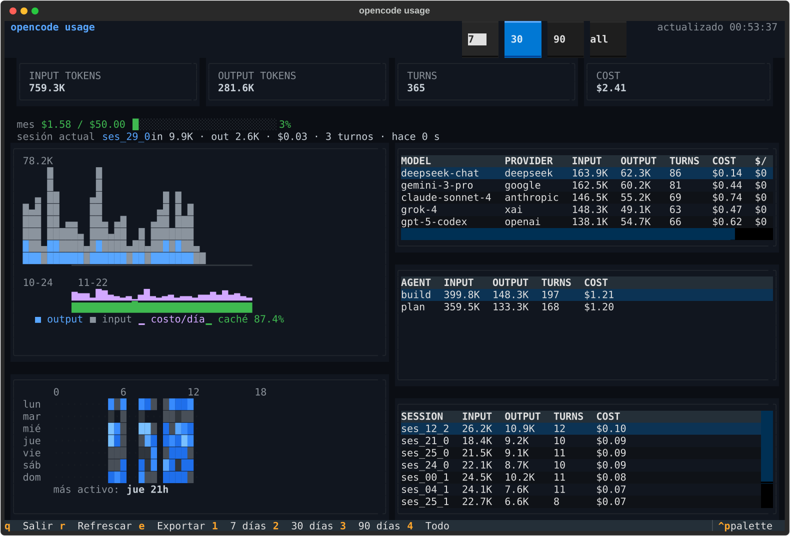

# opencode-usage

> Dashboard en terminal para medir tu uso de tokens de OpenCode: por modelo, por
> agente, por día, con costo, heatmap de actividad y ranking de sesiones.

[](https://github.com/Dann-13/new-stash/actions/workflows/ci.yml)
[](https://github.com/Dann-13/new-stash/releases)


[](LICENSE)

100% terminal (TUI con [Textual](https://textual.textualize.io/)). Lee la base de
datos local de OpenCode en **modo solo lectura**: no escribe nada, no envía
telemetría y, sin clave de DeepSeek, no hace ninguna conexión a internet.



## Qué hace

- **Tarjetas** de tokens de entrada/salida, turnos y costo, con % de caché.
- **Gráfica por día** (entrada + salida apiladas) con líneas de **costo** y
  **tendencia de caché**.
- **Heatmap** de actividad: día de la semana × hora, con el pico marcado.
- **Tablas** de modelos, agentes y **ranking de sesiones** por gasto.
- **Comparador de modelos**: costo por cada 1K tokens de salida.
- **Presupuesto mensual** con aviso al 80% y al 100% (solo informa, nunca bloquea).
- **Sesión actual en vivo**: tokens, costo, turnos y hace cuánto.
- **Saldo de DeepSeek** (opcional, solo si defines su clave).
- **Exportar** a CSV y Markdown eligiendo la carpeta.
- **Español e inglés** en toda la interfaz.
- **En vivo y ligero**: solo recalcula cuando cambia la base de datos.

## Requisitos

- Python **3.11 o superior**.
- [OpenCode](https://opencode.ai) instalado y con uso previo (para tener datos).

## Instalación

El paquete aún no está en PyPI: se instala directo desde GitHub. La forma más
simple es con [`pipx`](https://pipx.pypa.io/), que deja el comando `opencode-usage`
disponible en todo el sistema sin tocar tu Python global.

### Linux (Debian / Ubuntu)

```bash
sudo apt install pipx
pipx ensurepath                 # cierra y abre la terminal después
pipx install git+https://github.com/Dann-13/new-stash.git
```

### Windows (PowerShell)

```powershell
python -m pip install --user pipx
python -m pipx ensurepath       # cierra y abre la terminal después
pipx install git+https://github.com/Dann-13/new-stash.git
```

### Una versión concreta

```bash
pipx install git+https://github.com/Dann-13/new-stash.git@v0.5.0
```

### Actualizar o quitar

```bash
pipx upgrade opencode-usage
pipx uninstall opencode-usage
```

### Alternativa sin pipx (entorno virtual)

```bash
python3 -m venv ~/.venvs/opencode-usage
source ~/.venvs/opencode-usage/bin/activate
pip install git+https://github.com/Dann-13/new-stash.git
```

En Windows, activa con `.\.venv\Scripts\Activate.ps1` en lugar de `source`.

## Uso

```bash
opencode-usage
```

La app se actualiza sola cuando OpenCode escribe en su base de datos. Con
OpenCode quieto, consume casi nada de CPU.

### Atajos

| Tecla | Acción |
|-------|--------|
| `1` / `2` / `3` / `4` | ventana de 7 / 30 / 90 días / todo el histórico |
| `r` | refrescar ya |
| `e` | exportar CSV y Markdown (elige la carpeta en un diálogo) |
| `q` | salir |

### Opciones

```text
--db RUTA          ruta a opencode.db (default: la de OpenCode)
--refresh SEG      segundos entre revisiones de cambios (default: 5)
--days N           ventana inicial: 7, 30, 90 o 0 = todo (default: 30)
--lang es|en       idioma de la interfaz (default: config.toml o auto)
--export-dir RUTA  carpeta destino del export (default: config.toml o la actual)
```

La base de datos se busca en `$XDG_DATA_HOME/opencode/opencode.db`
(por defecto `~/.local/share/opencode/opencode.db` en Linux y
`%USERPROFILE%\.local\share\opencode\opencode.db` en Windows).

## Configuración (opcional)

Archivo `config.toml`:

- Linux: `~/.config/opencode-usage/config.toml`
- Windows: `%APPDATA%\opencode-usage\config.toml`

```toml
# Presupuesto mensual en USD. Sin esta línea, no hay presupuesto.
monthly_budget_usd = 20.0

# Idioma: "es", "en" o "auto" (detecta el del sistema).
language = "auto"

# Carpeta destino del export. Sin esta línea, se elige al exportar.
export_dir = "~/Documentos/usage"
```

Si el archivo tiene un error, la app sigue funcionando con valores por defecto
y muestra un aviso.

## Idiomas

Interfaz en español e inglés. Prioridad, de mayor a menor:

1. Línea de comandos: `opencode-usage --lang en`
2. `config.toml`: `language = "en"`
3. Automático: con `auto` se mira `LANG`/`LC_ALL` del sistema; sin pistas, español.

Se traduce todo lo visible: tarjetas, atajos, gráficas, presupuesto, sesión,
panel de DeepSeek, tablas, el Markdown exportado y los errores.

## Exportar

La tecla `e` abre un diálogo para elegir la carpeta destino. Escribe la ruta
(acepta `~`), `Enter` exporta y `Esc` cancela. La app recuerda la última carpeta
durante la sesión. El destino inicial sale de `--export-dir`, de `export_dir` en
`config.toml`, o de la carpeta actual, en ese orden.

Se escriben dos archivos:

- `opencode-usage-AAAAMMDD-HHMMSS.csv`: una fila por día (fecha, tokens, costo).
- `opencode-usage-AAAAMMDD-HHMMSS.md`: resumen de totales, modelos y agentes.

Si la carpeta no existe, se crea. Si no se puede usar, se avisa y no se exporta.

## DeepSeek (opcional)

Define la variable de entorno y arranca la app:

```bash
# Linux
export DEEPSEEK_API_KEY="tu-clave"
opencode-usage
```

```powershell
# Windows (PowerShell)
$env:DEEPSEEK_API_KEY = "tu-clave"
opencode-usage
```

El panel muestra saldo total, moneda y si hay saldo para llamadas. DeepSeek no
ofrece endpoint de uso por API: el uso por modelo de las tablas viene de la base
local de OpenCode.

## Privacidad y seguridad

- Solo lee `opencode.db` en modo solo lectura. Nunca escribe en ella.
- Sin telemetría. Los únicos archivos que crea son los que exportas con `e`.
- La clave de DeepSeek solo se lee de `DEEPSEEK_API_KEY`: no se pide en pantalla,
  no se guarda y no aparece en logs ni errores.
- Con clave, una única consulta HTTPS a `api.deepseek.com/user/balance` cada 60 s,
  en un hilo aparte. Solo lee el saldo: no puede gastar ni modificar tu cuenta.
- Sin clave, no hay ninguna conexión a internet.

Detalle completo en [docs/SECURITY.md](docs/SECURITY.md).

## Desarrollo

```bash
git clone https://github.com/Dann-13/new-stash.git
cd new-stash
python -m venv .venv
source .venv/bin/activate        # Windows: .\.venv\Scripts\Activate.ps1
pip install -e ".[dev]"
ruff check src tests
pytest
```

El CI corre `ruff` y `pytest` en Ubuntu y Windows con Python 3.11 y 3.12.

## Roadmap

Hecho: MVP, costo por día, presupuesto, sesión en vivo, export, DeepSeek, i18n,
ranking de sesiones, comparador de modelos y tendencia de caché.

Próximos pasos (Fase C, grupo medio):

- **Tokens/min** en vivo con sparkline de ritmo.
- **`--compact`**: vista mínima para terminales pequeñas.
- **Temas**: claro/oscuro y otros, vía archivos `.tcss`.

## Documentación

Las convenciones del proyecto viven en [`docs/`](docs/) y en
[`AGENTS.md`](AGENTS.md) (guía de entrada para agentes de IA y humanos).

| Tema | Archivo |
|---|---|
| Estructura y capas | [docs/ARCHITECTURE.md](docs/ARCHITECTURE.md) |
| Estilo y convenciones | [docs/CONVENTIONS.md](docs/CONVENTIONS.md) |
| Traducciones / i18n | [docs/I18N.md](docs/I18N.md) |
| Tests y CI | [docs/TESTING.md](docs/TESTING.md) |
| Seguridad y privacidad | [docs/SECURITY.md](docs/SECURITY.md) |
| Setup, versiones, roadmap | [docs/DEVELOPMENT.md](docs/DEVELOPMENT.md) |

## Licencia

[MIT](LICENSE) © 2026 Dann-13. Uso libre, sin garantía.
